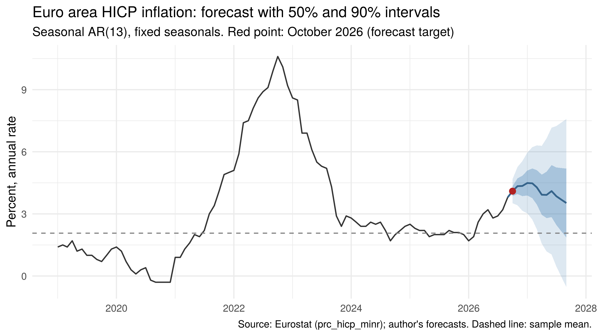

# Forecasting euro area inflation for October 2026

A one-month-ahead forecast of euro area HICP annual inflation, made with data up to September 2026 and before Eurostat published the October figure. I wrote it for Econ 460 (Economic Forecasting) at the University of Wisconsin-Madison in fall 2026. The full report is in [`paper/report.pdf`](paper/report.pdf).

**Forecast for October 2026: 4.1%**, with a 50% interval of 3.9% to 4.3% and a 90% interval of 3.5% to 4.7%.

**Eurostat flash estimate (November 4, 2026): 4.0%**, inside both intervals. The final figure comes out on November 18, 2026 (see [Evaluation](#evaluation)).



## Method

The annual inflation rate is approximately the sum of the last twelve monthly price changes, and for October 2026 eleven of those twelve months were already known. So instead of modelling the annual rate directly, I forecast the monthly change in the price index and rebuild the annual rate from the forecast index. Base effects then enter automatically.

The model for the monthly change has 11 monthly dummies and *p* autoregressive lags. The seasonal pattern of euro area prices has changed over time (sales have been recorded differently since 2011), so the candidates allow for this in two ways: a break in the seasonal dummies in 2011, or seasonal lags of 12 to 13 months.

To avoid picking the model by hand, the script applies a selection rule that I fixed in advance:

1. Estimate 30 candidates (fixed or 2011-break dummies, *p* = 0, ..., 14) on a common sample.
2. Drop the candidates whose residuals fail the Box-Pierce test at 5% (R = floor(sqrt(T)) = 18).
3. Choose the lowest BIC among the rest.

The rule selects an AR(13) with fixed seasonal dummies. Lags 12 and 13 let each month's seasonal effect update with the same month of the previous year, so the model does not need a break on a date I chose.

## Out-of-sample evaluation

The rule was applied again at every forecast origin from January 2015 to August 2026 (140 origins), using only the data available at each date. Root mean squared prediction error of the annual rate, in percentage points:

| Model | h = 1 | h = 3 | h = 6 | h = 12 | h = 1, excl. 2021-23 |
|---|---|---|---|---|---|
| **Seasonal AR (selection rule)** | **0.354** | **0.732** | **1.246** | **2.507** | **0.259** |
| AR(p) on the annual rate, BIC | 0.374 | 0.818 | 1.428 | 2.678 | 0.305 |
| ARMA(1,1) on the annual rate | 0.407 | 0.913 | 1.578 | 2.692 | 0.291 |
| Random walk | 0.421 | 0.926 | 1.589 | 2.767 | 0.296 |
| Sample mean | 2.511 | 2.534 | 2.576 | 2.649 | 0.960 |

The selection rule has the lowest error at every horizon, although the gain over the AR for the annual rate at one month is small. Alternative specifications (other lag lengths, the 2011 break, or Box-Pierce with R - p degrees of freedom) give October forecasts between 4.01% and 4.15% (`output/robustness_specifications.csv`).

The intervals are the forecast plus or minus z times the standard deviation of the out-of-sample errors at each horizon. In the evaluation sample, 91% of the one-month errors fall inside the 90% interval and 62% inside the 50% interval (`output/interval_coverage.csv`).

## How to run it

Requirements: R (tested with R 4.3.3), `dplyr` (1.1.4) and `ggplot2` (3.4.4). The `eurostat` package is only needed to download new data.

```r
install.packages(c("dplyr", "ggplot2"))
source("forecast.R")   # run from the repository folder; takes about 30 seconds
```

By default (`DOWNLOAD <- FALSE`) the script reads `data/hicp_data.csv`, the data used in the report, so it reproduces the numbers above exactly. With `DOWNLOAD <- TRUE` it downloads the latest data from Eurostat, and the results will change as new months are added or past data are revised.

## Data

Eurostat, dataset `prc_hicp_minr`: euro area (changing composition), all-items HICP, annual rate of change and index (2025 = 100), monthly, January 1997 to September 2026. Downloaded in October 2026 with the R package `eurostat`; the last observation (September 2026) is the final figure released on October 16, 2026.

## Repository structure

```
forecast.R          the whole analysis: data, models, selection rule, evaluation, forecast
data/               the data used in the report
output/             tables (.csv) and figures (.png) produced by forecast.R
paper/              the report (PDF and LaTeX source); it also uses three figures from output/
```

The script has seven parts: settings, data, exploration (ACF/PACF and seasonality), models and the selection rule, out-of-sample evaluation, the final forecast with intervals, residual diagnostics, and robustness checks.

## Limitations

The model is univariate, so it does not see energy prices, which drive much of the monthly volatility. The largest single contribution to the October forecast comes from the April 2026 price increase (energy and Easter) through lag 6. The intervals are wide at longer horizons because the evaluation sample includes 2021-23. The evaluation uses the current vintage of the data, not the data available at each date.

## Evaluation

*Preliminary, based on the flash estimate. I will update it with the final figure on November 18, 2026.*

Eurostat's flash estimate puts euro area annual inflation in October 2026 at 4.0%, up from 3.8% in September. My forecast was 4.10%, so the error (actual minus forecast) is -0.1 percentage points.

| | October 2026 |
|---|---|
| Flash estimate (Eurostat, November 4) | 4.0% |
| My forecast | 4.10% |
| My 50% interval | 3.86% to 4.34% |
| My 90% interval | 3.52% to 4.68% |
| Market consensus | 4.0% |

The flash value falls inside my 50% interval. The error is about 0.3 times the standard deviation of the model's one-month errors since 2015 (0.354), so it is smaller than a typical error of the model. The model got the direction right: prices rose more this October than in October 2025, so the annual rate went up from 3.8%. The market consensus was exactly right and my forecast was one decimal too high.

By component, energy prices were 20.8% higher than a year earlier (18.9% in September), services inflation was 3.3% (3.2%), food, alcohol and tobacco 1.6% and non-energy industrial goods 1.2%. My model is univariate, so I cannot compare it with these components directly. One possible reason for the small overshoot is lag 6, which carried about half of the predicted monthly increase from April 2026, a month pushed up by energy prices and Easter. With a single observation this is only a guess.

## Author

Álvaro Cavero Miguel, Economics student at Universidad Carlos III de Madrid, exchange student at the University of Wisconsin-Madison.
